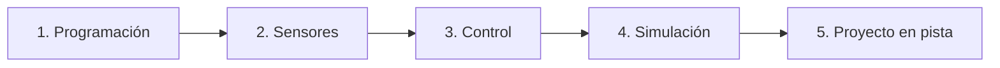

# Ruta formativa: Fundamentos de autos autónomos

El área de vehículos autónomos trabaja en autos a escala capaces de recorrer pistas, detectar líneas, esquivar obstáculos y tomar decisiones en tiempo real sin intervención humana.

Esta ruta presenta el mapa formativo paso a paso: **Programación → Sensores → Control → Simulación → Proyecto**.

---

## Ficha de la ruta

- **Objetivo:** Comprender la arquitectura de un vehículo autónomo y desarrollar algoritmos básicos de control lógico.
- **Nivel:** Inicial / Intermedio.
- **Prerrequisitos sugeridos:** Nociones básicas de Python y Git.
- **Materiales oficiales:**
  - [Tutorial oficial de Python](https://docs.python.org/3/tutorial/): repaso de estructuras de control y funciones.

---

## Etapas formativas

### 1. Programación básica de control
El cerebro del auto ejecuta un bucle continuo: lee sensores, procesa datos y calcula qué velocidad y ángulo de dirección enviar a los motores.

### 2. Sensores del vehículo
- **Cámara:** Detecta los bordes de la pista, marcas viales y obstáculos frontales mediante visión artificial.
- **LiDAR o sensores de distancia (ultrasonido / infrarrojo):** Miden la distancia a paredes o vehículos cercanos.
- **Encoders:** Cuentan las vueltas de las ruedas para estimar la velocidad y distancia recorrida (odometría).
- **IMU (Unidad de Medición Inercial):** Informa giros, aceleraciones y orientación angular.

### 3. Algoritmos de control
- **Control todo o nada (Bang-Bang):** Si la línea está a la izquierda, doblar a la derecha; si está a la derecha, doblar a la izquierda. Sencillo pero genera oscilaciones.
- **Control proporcional (P / PID):** Cuanto más lejos esté el auto del centro del carril, mayor es el ángulo de corrección. Produce un manejo mucho más suave.

### 4. Simulación
Antes de poner el auto en una pista real, probamos el software en simuladores robóticos para no golpear el chasis ni dañar componentes.

### 5. Integración en el vehículo físico
Carga del software en la computadora de a bordo del auto, calibración de sensores en pista y pruebas de competencia.

---

## ¿Qué podés aprender sin auto físico ni computadora potente?

No necesitás tener el vehículo a mano ni una PC de última generación para avanzar en esta área:
- **Escribir algoritmos de control en Python puro:** Podés programar y probar en tu celular o cualquier computadora sencilla una función que reciba una distancia ficticia y devuelva la velocidad calculada.
- **Entender el funcionamiento de los sensores:** Estudiar cómo convierte una cámara los píxeles a coordenadas o cómo funciona el tiempo de vuelo de un sensor ultrasónico.
- **Diseñar la lógica de estados:** Crear diagramas para situaciones como «arranque», «seguimiento de carril», «obstáculo detectado» y «parada de emergencia».

---

## Entregable sugerido

Escribí un script en Python (o un documento explicativo si estás desde celular) que implemente una función básica de control: dada la posición del centro de la línea respecto al centro de la cámara (error en píxeles), devolver el ángulo de giro de la dirección corregido.

---

## Criterio de finalización

Un mentor verificará:
1. Claridad en la explicación de las etapas (Programación, Sensores, Control, Simulación).
2. Lógica correcta del algoritmo de control presentado.
3. Respeto a las pautas de seguridad (comprender por qué se simula antes de probar en el auto físico).

---

> ⚠️ Pendiente de completar por el equipo: modelo específico del vehículo a escala (categoría FIRA u otra), chasis utilizado, sensores montados y microcomputadora de a bordo (Raspberry Pi / Jetson).
