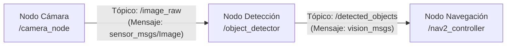

# Ruta formativa: Primer contacto con ROS 2

**ROS 2** (*Robot Operating System 2*) es el estándar de facto en la industria y la investigación para construir aplicaciones robóticas. No es un sistema operativo como Windows o Linux, sino un conjunto de herramientas y bibliotecas (*middleware*) que permite comunicar los distintos programas que controlan a un robot.

---

## ⚠️ Nota importante sobre versiones y distribuciones

> **Distribución estable del equipo:** La distribución de ROS 2 utilizada oficialmente en los equipos del laboratorio está **pendiente de confirmación** (habitualmente versiones con soporte extendido LTS como Humble Hawksbill o Jazzy Jalisco).
> **Regla de oro:** **No utilizar distribuciones «Rolling»** para entornos de trabajo del laboratorio, ya que son de desarrollo continuo y pueden romper la estabilidad de los paquetes.

---

## Ficha de la ruta

- **Objetivo:** Comprender la arquitectura de comunicación por mensajes de ROS 2 (nodos, tópicos, servicios y acciones).
- **Nivel:** Inicial / Principiante.
- **Materiales oficiales:**
  - [Documentación oficial de ROS 2](https://docs.ros.org/): tutoriales, conceptos de arquitectura y comandos de CLI.
  - [Documentación oficial de Gazebo](https://gazebosim.org/docs): conceptos de simulación física en robótica.

---

## Conceptos fundamentales

### 1. Nodos (*Nodes*)
Un nodo es un proceso ejecutable independiente que realiza una tarea específica (por ejemplo, leer una cámara, controlar motores o calcular un mapa). Un robot complejo está compuesto por decenas de nodos comunicándose entre sí.

### 2. Tópicos y Mensajes (*Topics & Messages*)
El mecanismo principal de comunicación es el patrón **publicador / suscriptor** (*publish/subscribe*):
- Un nodo **publica** información en un canal con nombre (el *tópico*).
- Otros nodos interesados se **suscriben** a ese canal para recibir los datos de manera continua.
- Los datos viajan estructurados en tipos de mensajes definidos (`std_msgs`, `geometry_msgs`, `sensor_msgs`).

### 3. Servicios (*Services*)
A diferencia de los tópicos (flujo continuo unidireccional), los servicios siguen un esquema de **petición / respuesta** (*request/response*). Se usan para acciones discretas, como pedir un cálculo puntual o encender una luz.

### 4. Acciones (*Actions*)
Para tareas de larga duración que pueden cancelarse o de las que se necesita saber el progreso periódico (por ejemplo: "navegá hasta la cocina"). Incluyen meta (*goal*), retroalimentación (*feedback*) y resultado final (*result*).

---

## ¿Qué podés aprender sin instalar nada pesado?

ROS 2 puede requerir bastante espacio en disco y tiempo de instalación. Sin embargo, podés dominar los conceptos teóricos fundamentales desde el celular o cualquier computadora:
- Aprender a diagramar qué nodos necesita un robot (sensores, procesamiento, actuadores).
- Entender el formato de los mensajes más comunes (`geometry_msgs/msg/Twist` para velocidades lineales y angulares).
- Leer código fuente de nodos en Python para ver cómo se estructuran las clases y llamadas de retorno (*callbacks*).

---

## Entregable y criterio de finalización

Diseñá un diagrama conceptual (en texto, tabla o dibujo) de un robot móvil ficticio que limpie un piso:
1. Indicá al menos tres nodos que interactúan.
2. Definí los tópicos que los comunican y qué información viaja por cada uno.

Un mentor comprobará que:
1. El modelo respete el desacoplamiento nodo-tópico de ROS 2.
2. Se entienda la diferencia entre un publicador y un suscriptor.
3. Se reconozca la importancia de usar distribuciones estables (LTS).

---

> ⚠️ Pendiente de completar por el equipo: distribución oficial de ROS 2 utilizada en los robots y simuladores del laboratorio (ej. Humble o Jazzy), y paquetes base a instalar.
