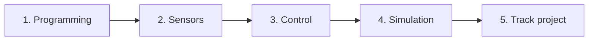

# Learning path: Autonomous car fundamentals

The autonomous vehicle area works on scale cars capable of driving around tracks, detecting lines, avoiding obstacles and making decisions in real time without human intervention.

This path presents the step-by-step training map: **Programming → Sensors → Control → Simulation → Project**.

---

## Path card

- **Goal:** Understand the architecture of an autonomous vehicle and develop basic logic control algorithms.
- **Level:** Initial / Intermediate.
- **Suggested prerequisites:** Basic notions of Python and Git.
- **Official materials:**
  - [Official Python tutorial](https://docs.python.org/3/tutorial/): review of control structures and functions.

---

## Training stages

### 1. Basic control programming
The car's brain runs a continuous loop: it reads sensors, processes data and calculates what speed and steering angle to send to the motors.

### 2. Vehicle sensors
- **Camera:** Detects track edges, lane markings and frontal obstacles using computer vision.
- **LiDAR or distance sensors (ultrasonic / infrared):** Measure the distance to nearby walls or vehicles.
- **Encoders:** Count wheel rotations to estimate speed and distance traveled (odometry).
- **IMU (Inertial Measurement Unit):** Reports turns, accelerations and angular orientation.

### 3. Control algorithms
- **Bang-bang control:** If the line is on the left, turn right; if it's on the right, turn left. Simple but generates oscillation.
- **Proportional control (P / PID):** The farther the car is from the center of the lane, the greater the correction angle. Produces much smoother driving.

### 4. Simulation
Before putting the car on a real track, we test the software in robotic simulators to avoid hitting the chassis or damaging components.

### 5. Integration into the physical vehicle
Loading the software onto the car's onboard computer, calibrating sensors on the track and running competition tests.

---

## What can you learn without a physical car or a powerful computer?

You don't need to have the vehicle at hand or a top-of-the-line PC to advance in this area:
- **Write control algorithms in pure Python:** You can program and test on your phone or any simple computer a function that receives a fictional distance and returns the calculated speed.
- **Understand how sensors work:** Study how a camera converts pixels to coordinates or how an ultrasonic sensor's time-of-flight works.
- **Design state logic:** Create diagrams for situations like "start", "lane following", "obstacle detected" and "emergency stop".

---

## Suggested deliverable

Write a Python script (or an explanatory document if you're on a phone) that implements a basic control function: given the position of the line's center relative to the camera's center (error in pixels), return the corrected steering angle.

---

## Completion criteria

A mentor will verify:
1. Clarity in explaining the stages (Programming, Sensors, Control, Simulation).
2. Correct logic of the presented control algorithm.
3. Respect for safety guidelines (understanding why we simulate before testing on the physical car).

---

> ⚠️ Pending completion by the team: specific scale vehicle model (FIRA or other category), chassis used, mounted sensors and onboard microcomputer (Raspberry Pi / Jetson).
