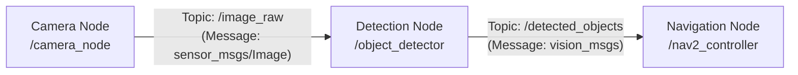

# Learning path: First contact with ROS 2

**ROS 2** (*Robot Operating System 2*) is the de facto standard in industry and research for building robotic applications. It's not an operating system like Windows or Linux, but a set of tools and libraries (*middleware*) that lets the different programs controlling a robot communicate.

---

## ⚠️ Important note on versions and distributions

> **Team's stable distribution:** The ROS 2 distribution officially used on the lab's machines is **pending confirmation** (usually long-term-support LTS versions like Humble Hawksbill or Jazzy Jalisco).
> **Golden rule:** **Do not use "Rolling" distributions** for lab work environments, since they are under continuous development and can break package stability.

---

## Path card

- **Goal:** Understand ROS 2's message-based communication architecture (nodes, topics, services and actions).
- **Level:** Initial / Beginner.
- **Official materials:**
  - [Official ROS 2 documentation](https://docs.ros.org/): tutorials, architecture concepts and CLI commands.
  - [Official Gazebo documentation](https://gazebosim.org/docs): physical simulation concepts in robotics.

---

## Core concepts

### 1. Nodes
A node is an independent executable process that performs a specific task (for example, reading a camera, controlling motors or computing a map). A complex robot is made up of dozens of nodes communicating with each other.

### 2. Topics & Messages
The main communication mechanism is the **publish/subscribe** pattern:
- A node **publishes** information on a named channel (the *topic*).
- Other interested nodes **subscribe** to that channel to receive the data continuously.
- Data travels structured in defined message types (`std_msgs`, `geometry_msgs`, `sensor_msgs`).

### 3. Services
Unlike topics (continuous one-way flow), services follow a **request/response** scheme. They're used for discrete actions, like requesting a one-off calculation or turning on a light.

### 4. Actions
For long-running tasks that can be cancelled or whose progress needs to be known periodically (for example: "navigate to the kitchen"). They include a goal, feedback and a final result.

---

## What can you learn without installing anything heavy?

ROS 2 can require a lot of disk space and installation time. However, you can master the core theoretical concepts from your phone or any computer:
- Learn to diagram which nodes a robot needs (sensors, processing, actuators).
- Understand the format of the most common messages (`geometry_msgs/msg/Twist` for linear and angular velocities).
- Read node source code in Python to see how classes and callbacks are structured.

---

## Deliverable and completion criteria

Design a conceptual diagram (in text, table or drawing) of a fictional mobile robot that cleans a floor:
1. Indicate at least three nodes that interact.
2. Define the topics that connect them and what information travels on each one.

A mentor will check that:
1. The model respects ROS 2's node-topic decoupling.
2. The difference between a publisher and a subscriber is understood.
3. The importance of using stable (LTS) distributions is recognized.

---

> ⚠️ Pending completion by the team: official ROS 2 distribution used on the lab's robots and simulators (e.g. Humble or Jazzy), and base packages to install.
